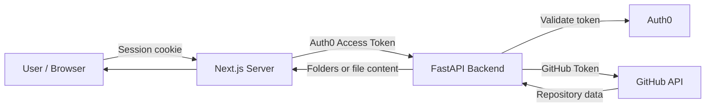
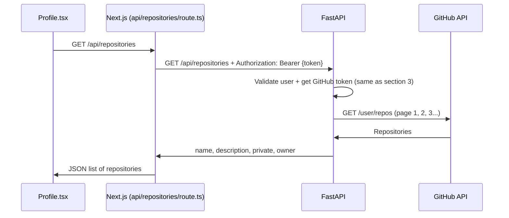
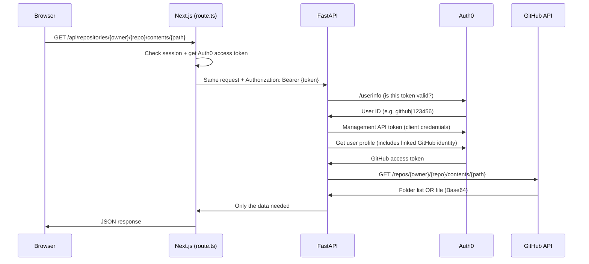
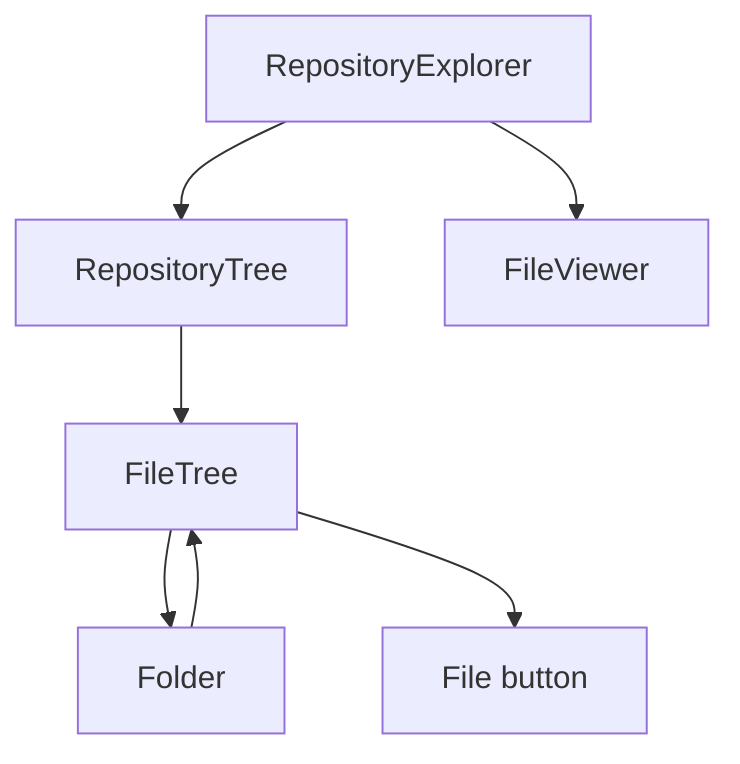

# Codebase AI - Project Overview

This document gives an overview of **Codebase AI**: what it is, how it is built and how all the different parts work together. It reflects the current state of the project and what I am planning to build next.

---

## What is Codebase AI?

Imagine you are working in a project and you have a repository with dozens or hundreds of different files and you forgot what one specific file did or where to find it. This has happened to me various times, so I decided to create a program to deal with this - **Codebase AI**.

The idea is simple:
1. The user logs in with their GitHub account
2. The user selects one of their repositories
3. Codebase AI reads the repository
4. The user asks questions about the code and gets answers that point to the exact files where the answer comes from

---

## Tech Stack

| Part | Technology | Why |
| --- | --- | --- |
| Frontend | Next.js 16 (App Router), React 19, TypeScript | I already had experience with React and Next.js |
| Styling | TailwindCSS v4 | Fast to style components directly in the JSX |
| Authentication | Auth0 (`@auth0/nextjs-auth0`) with GitHub login | Auth0 handles sessions, social login and tokens so I don't build my own login system |
| Backend | Python, FastAPI | Python is the main language for AI work, and FastAPI is fast and generates interactive docs |
| HTTP client | `httpx` (async) | Lets the backend make requests to Auth0 and GitHub without blocking the server |
| Package manager | `uv` | Fast, and creates a lockfile (`uv.lock`) |
| External API | GitHub REST API (Contents API) | Where the repository data actually comes from |

---

## Project Structure

```
codebase-ai/
|-- backend/
|   |-- main.py              # FastAPI app: authentication + GitHub requests
|   |-- pyproject.toml       # Python dependencies
|   |-- uv.lock
|
|-- frontend/
|   |-- proxy.ts             # Protects routes (redirects depending on login)
|   |-- lib/
|   |   |-- auth0.ts         # Auth0 client instance
|   |   |-- api.ts           # Helper functions + types to request repository data
|   |-- app/
|       |-- page.tsx                 # Home page
|       |-- login/page.tsx           # Login with GitHub
|       |-- profile/page.tsx         # Profile + repository input
|       |-- profile/[owner]/[repoName]/page.tsx   # Repository explorer page
|       |-- api/repositories/[owner]/[repoName]/contents/[[...path]]/route.ts
|       |                            # Next.js server route that talks to FastAPI
|       |-- components/
|           |-- Profile.tsx
|           |-- svgLogo.tsx
|           |-- repository-explorer/
|               |-- RepositoryExplorer.tsx   # Main explorer (state + file selection)
|               |-- components/
|               |   |-- RepositoryTree.tsx   # Folder tree (recursive)
|               |   |-- FileViewer.tsx       # Shows the content of a file
|               |-- types/repositoryExplorer.ts
|               |-- utils/sortEntries.ts     # Folders first, then files (A-Z)
```

---

## How It Works

### The Big Picture



There are three main layers:
1. **Browser (React components)** - shows the UI and asks for data when the user clicks something
2. **Next.js server (`route.ts`)** - checks the user is logged in and adds the access token to the request
3. **FastAPI backend (`main.py`)** - verifies the user, gets their GitHub token and requests the data from GitHub

---

### 1. Logging In

The login button sends the user to:

```
/auth/login?connection=github&connection_scope=repo&returnTo=/profile
```

- `connection=github` skips the Auth0 screen and goes straight to GitHub login
- `connection_scope=repo` asks GitHub for permission to read the user's repositories (including private ones)
- `returnTo=/profile` sends the user to their profile once they are logged in

Once the user logs in, Auth0 creates a **session** (stored in a cookie).

#### Protecting Pages - `proxy.ts`

`proxy.ts` runs before every request and decides where the user can go:

| Situation | What happens |
| --- | --- |
| Logged in + visiting `/` or `/login` | Redirected to `/profile` |
| Not logged in + visiting `/profile/...` | Redirected to `/` |
| Anything else | Request continues normally |

---

### 2. Choosing a Repository
 
When the profile page loads, `Profile.tsx` requests the list of repositories the user has access to and shows each one with its name, description and whether it is **Public** or **Private**.
 

 
The backend asks GitHub for every repository the user:
- **Owns**
- Is a **collaborator** on
- Can access as an **organisation member**
```python
params={
    "visibility": "all",
    "affiliation": "owner,collaborator,organization_member",
    "per_page": per_page,
    "page": page,
},
```
 
>[!learned] Pagination
>GitHub doesn't return all the repositories at once. It returns them in **pages** (maximum 100 per page).
>
>The backend keeps requesting the next page until a page comes back with less than 100 repositories, which means it was the last one.
 
Clicking a repository takes the user to:
 
```
/profile/{owner}/{repoName}
```
 
The `owner` comes from GitHub (`repository["owner"]["login"]`) and not from the logged-in user. This means repositories from organisations or other people can also be opened.
 
The URL itself says which repository is being explored. This means there is no need to "save" the selected repository in the backend first.
 
>**WARNING: Organisation Repositories**
>
>If an organisation has **OAuth app access restrictions** turned on, its repositories won't appear until an organisation admin approves the app. This is a GitHub setting and not something the code can fix.
 
>**NOTE: Earlier Versions**
>
>**Version 1:** the frontend sent the repository name to the backend with a `POST` request, and the backend saved it in a global dictionary (`user_dict`). Then a separate `GET` request read it. This was a problem because the dictionary is shared by **every user**. If two users selected a repository at the same time, one could read the other one's selection.
>
>**Version 2:** the repository went in the URL instead, so everything the backend needs is inside each request. But the user still had to type the repository name in an input box, and the owner was always the logged-in user (`user.nickname`). This meant only the user's own repositories could be opened, and a typo would just give an error.
>
>**Version 3 (current):** the user picks from a list of their real repositories, and the owner comes from GitHub.

---

### 3. Requesting Repository Data

When the explorer page opens, or the user clicks a folder or a file, this happens:



#### The Three Tokens

This is the part that confused me the most, so I am writing it down clearly:

| Token | Who uses it | What it is for |
| --- | --- | --- |
| **Auth0 access token** | Next.js → FastAPI | Proves to FastAPI which user is making the request |
| **Management API token** | FastAPI → Auth0 | Lets my backend read the user's profile from Auth0 |
| **GitHub access token** | FastAPI → GitHub | Lets my backend read the user's repositories |

>[!important] Security>
>The Auth0 application needs the scopes `read:users` and `read:user_idp_tokens` for the Management API part to work. These are set in the Auth0 dashboard, not in the code.

#### Why have a Next.js route in the middle?

Before, the browser called FastAPI directly and sent the token itself. This meant the token was available in browser JavaScript (and I was even logging it).

Now `route.ts` acts as a **Backend-for-Frontend (BFF)**:
- The browser only talks to my own Next.js server (same origin)
- Next.js reads the token on the server and forwards the request to FastAPI

FastAPI still checks the token again with Auth0. This is because FastAPI is a separate server, so it shouldn't trust that every request came through Next.js.

---

### 4. The Backend Response

GitHub's Contents API returns **two different shapes** depending on the path:

- **Folder** → a list of entries. The backend only returns `name`, `path` and `type` for each one.
- **File** → one object with the content encoded in **Base64**. The backend decodes it into normal text before sending it.

```python
file_content = b64decode(contents["content"]).decode("utf-8")
```

If the file isn't text (e.g. an image), decoding fails and the backend returns an error instead.

#### Error Handling

| Status | Meaning |
| --- | --- |
| `401` | User isn't logged in or the token is invalid/expired |
| `403` | No GitHub connection, or GitHub denied access to the repository |
| `404` | Repository or path not found |
| `415` | The item can't be displayed (not a text file) |
| `502` | GitHub or the backend had a server error |

---

### 5. The Repository Explorer

The explorer is split into two panels: the **file tree** on the left and the **file viewer** on the right.



#### Recursive Folders
A repository can have any number of folders inside folders, so I can't write separate code for each level. Instead:
- `FileTree` renders a list of entries
- If an entry is a folder, it renders a `Folder`
- When a `Folder` is opened, it renders another `FileTree` with its children

Each `Folder` has its own state (`isExpanded`, `entries`, `isLoading`, `error`).

#### Lazy Loading
Only the root of the repository is loaded at the start. A folder's content is only requested when the user opens it. Once it is loaded, it stays in memory, so closing and reopening the folder doesn't make another request.

#### File Cache
Files that have already been opened are saved in a `useRef` cache. Opening the same file again doesn't make another request. I used `useRef` instead of `useState` because changing the cache doesn't need to re-render the page.

#### Race Conditions:
If the user clicks a big file and then quickly clicks a small one, the small one can finish first and then the big one could overwrite it.

To prevent this, `selectedPath` stores the latest file clicked, and a response is only shown if it still matches that path.

---

## Current Progress

#### Part 1 - Initial Frontend Design
- [x] Set up frontend
- [x] Create initial MVP of login page
- [x] Create connection of login via GitHub
#### Part 2 - Establishing with Backend
- [x] Create a backend
- [x] Establish connection with Backend
- [x] Send user data to backend
#### Part 3 - Establishing Connection with GitHub API
- [x] Establish connection to GitHub API
- [x] Get Repository Data and send back to backend
- [x] Send all this data to frontend
- [x] Frontend displays data appropriately (Repository Explorer)
- [x] Access private repositories
- [x] Remove global state and hardcoded user ID
- [x] List all the user's repositories (own, collaborator and organisation) instead of typing the name
#### Part 4 - Design the Main AI Functionality
- [ ] **Ingestion** - download the whole repository at once and filter out files that aren't useful (e.g. `node_modules`, lockfiles, images)
- [ ] **Chunking** - split the code into smaller pieces (by function/class) and keep the file path and line numbers
- [ ] **Embeddings** - turn each chunk into a vector and store it in SQLite
- [ ] **Question Answering** - find the most relevant chunks for a question and send them to the model
- [ ] **Citations** - every answer points to the files and lines it used, and clicking one opens it in the explorer
- [ ] **Chat UI** - stream the answer into a chat panel next to the explorer
#### Part 5 - Making it Production Ready
- [ ] Database for users, repositories and chat history
- [ ] Re-index the repository when it changes
- [ ] Evaluation set to measure how accurate the answers are
- [ ] Tests for the backend
- [ ] Deployment

---

## Known Limitations

>[!warning] Things to fix
>- The owner is always the logged-in user, so organisation repositories or other people's repositories can't be opened yet
>- Every request creates a new Management API token. This should be cached, as Auth0 limits how many can be created
>- A new `httpx.AsyncClient` is created for every request instead of reusing one
>- Files larger than 1MB are not returned by the Contents API with their content
>- Only the default branch can be explored
>- There are no automated tests yet

---

## Running the Project

### Backend
From `backend/` (Python 3.14 or newer):

```bash
uv sync
uv run --env-file .env fastapi dev main.py
```

`.env` needs:
```
AUTH0_DOMAIN=
AUTH0_CLIENT_ID=
AUTH0_CLIENT_SECRET=
```

The API runs at `http://localhost:8000` and the interactive docs at `http://localhost:8000/docs`.

### Frontend
From `frontend/`:

```bash
npm ci
npm run dev
```

The app runs at `http://localhost:3000`. The Auth0 variables go in `.env.local` (see the Auth0 Next.js quickstart), and `NEXT_PUBLIC_BACKEND_URL` can be set if the backend isn't at `http://localhost:8000`.